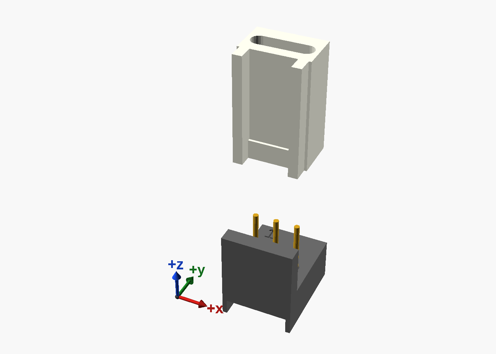
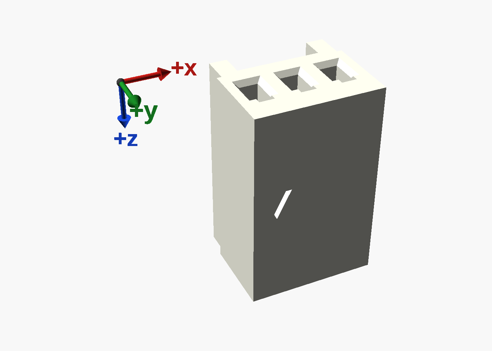
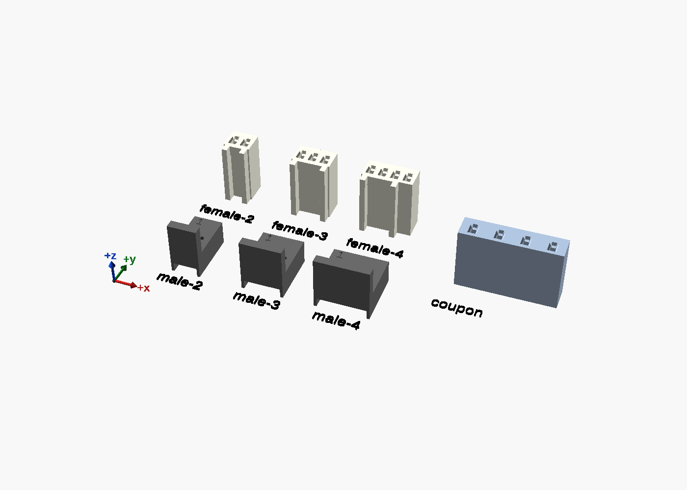

# 2.54 mm fan connector

A printed **male header** and **female plug**, 2, 3 or 4 pins, for the 2.54 mm connectors fans use. The 3-pin
fits the usual fan plug of the KK 254 kind; the 4-pin is keyed as 4-pin fan connectors are, so a 3-pin plug goes on
it too. The male's pins and the female's contacts are **22 AWG solid wire**, bared: no crimp terminals, no crimper.

**Status: drawn and checked, not printed yet** (9 Oct 2026). The female's contact is a first design: print the
coupon first (below).

| File | What |
|---|---|
| [`fan-connector.scad`](fan-connector.scad) | The whole model, one self-contained file: the Customizer's groups are the settings |
| `fan-connector-male-2.scad` ... `-male-4.scad` | The male, 2, 3 and 4 pins, as it prints: on its underside |
| `fan-connector-female-2.scad` ... `-female-4.scad` | The female, as it prints: standing on its back end, the open end up |
| [`fan-connector-coupon.scad`](fan-connector-coupon.scad) | The female's fit coupon: four cavities, one at each trial interference |
| [`fan-connector-figures.scad`](fan-connector-figures.scad), [`figures.sh`](figures.sh) | The pictures, rendered |
| [`printables.md`](printables.md) | The Printables listing, drafted |

## How it works

- **The male.** Each wire comes up through the block from below. Its insulation stops at the top of a slot, so it
  cannot be pulled out upwards, and its bared core stands 6 mm above the block as the pin: 0.64 mm, a header pin's
  size. Under the block the wires bend over into a groove to the back edge; fixed down, the block traps that bend,
  so a plug going on cannot push a pin down. Bare each wire **7.5 mm**.
- **One way on.** A wall stands behind the plug's ribbed face, and a key on it goes between the plug's two ribs.
  The key sits over pins 1 to 3, as on 4-pin fan headers, so a 3-pin plug fits the 4-pin male.
- **The female.** Each wire comes in from the back end: its insulation in a slot, its bared core on through a
  hole and down its pin's cavity along the text side's wall, and its tip bent over into a notch in the open end -
  which stops it being pulled back out. A pin going in squeezes past the wire by `interference` (0.05 mm), and that
  squeeze is the contact. Bare each wire **10 mm**.
- **Pin 1** is marked: a **1** on the male's top in front of it, an arrow on the female's text face.

### The coupon: find the interference on your printer

The squeeze is of the same order as a printer's tolerance, so it is found by printing, not chosen. The coupon has
four cavities numbered 1 to 4 on its face, at 0, 0.05, 0.10 and 0.15 mm. Thread a wire into each as for the female,
push a header pin (or a bared 22 AWG core) in and out a few times, and set `interference` to the one that holds
firmly and still lets the pin in.

## Printing

- 0.2 mm layers, 0.4 mm nozzle; no supports, no brim. ASA or PETG.
- Each part prints as its file draws it. Under a gram each; 10 to 18 minutes.
- The cores' holes are cut 0.94 mm for a 0.64 mm core. If one prints closed, open it with the wire itself or a
  0.7 mm drill.

## Measured, and not

Drawn from one 3-pin fan plug measured with calipers (9 Oct 2026) and the 2.54 mm pitch. No other model was used.

| Value | | |
|---|---|---|
| Across the pins, 3-pin (A) | 8.0 mm | measured; each pin more adds 2.54 |
| Thickness without the ribs (B) | 5.2 mm | measured, over a 0.3 mm lip across the open end between the ribs |
| Length along the wires (C) | 12.77 mm | measured |
| Text face to a hole's near wall (D) | 2.55 mm | measured |
| A pin's hole | 1.45 mm | measured |
| Ribs | 1.1 wide, 5.2 apart, 6.67 over them | measured (an NZXT fan's: 0.92 wide, 1.08 proud) |
| The lip's length along the plug | 2.2 mm | measured (an NZXT fan's plug: 1.9) |
| 2-pin: the ribs' place | 0.3 mm in from the ends, as on the 3-pin | **to confirm** on a real 2-pin plug |
| 22 AWG insulation's outside | 1.6 mm | measured |
| The female's interference | 0.05 mm | **to find** with the coupon |

## Checks

`uv run scripts/fan-connector-checks.py` (from the repository's root) checks every pin count: the female seated
on the male, clear of its key and wall; the male's pins through both, touching neither; and a header's square pin
in each of the female's cavities. Each check must come out empty, and each has positive controls that break it
from one side - the key widened, the wall moved in, the holes and cavities narrowed - which it must catch:
**27 of 27** as they must be (9 checks, 18 controls). Every part passes `scripts/scad-check.sh`: one closed body,
sliced with no supports.

The model's asserts, each seen to fire on the value that breaks it:

| Override | Blocks with |
|---|---|
| `pins=5` | pins: 2, 3 or 4 |
| `rib=[1.1,1.0,6.67]` | the male's key must be wide enough to print and stand out from its wall |
| `male_base=[3,1.5]` | the male's block must hold the insulation's slot under the cores' holes |
| `pitch=1.5` | the female's cavities must leave a line of wall between them |
| `f_cav=[1.14,-1.3]` | the female's cavities must leave two lines of wall to the ribbed face |
| `female_hook=[0.8,3]` | the female's contacts and their hooks must stay inside the text face |
| `female_depth=9` | the female's cavities must stop short of the insulation's slot |
| `rib=[1.1,7.0,6.67]` | the ribs must fit on the plug, with a key between them |

## Names

"KK 254" is Molex's name for its connector family, used here only to say what the parts fit. This is not a Molex
part, and the files say "fan connector".
